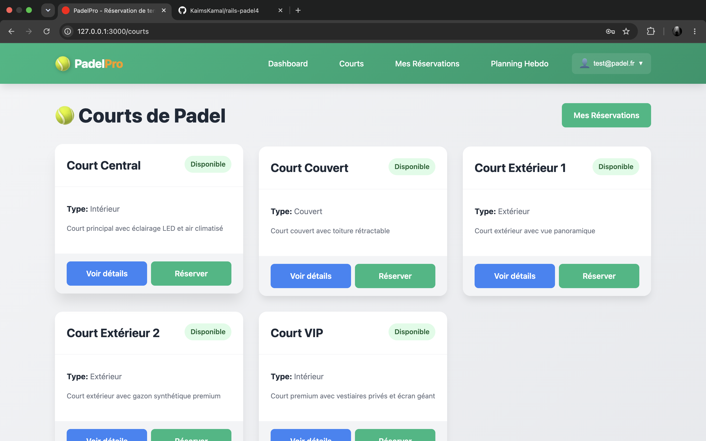
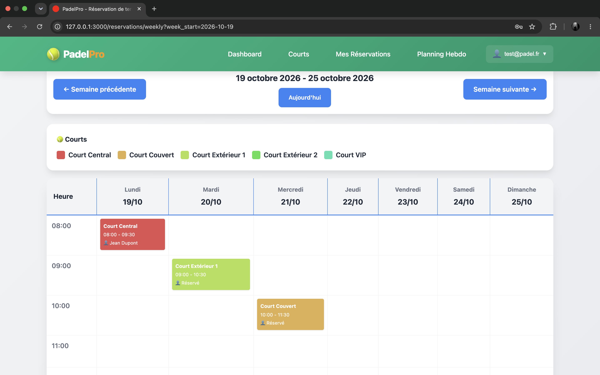
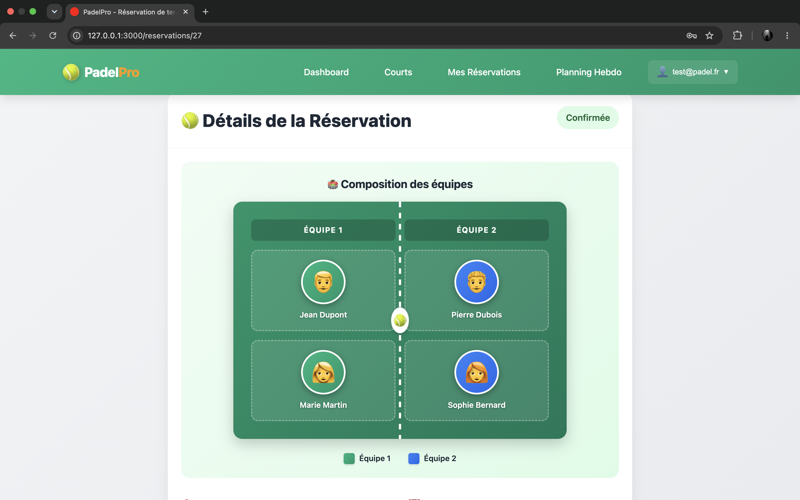

# PadelPro — Réservation de terrains de padel

Application web Rails de réservation de terrains de padel : comptes utilisateurs, planning hebdomadaire, prévention des doublons de créneaux et visualisation interactive des 4 joueurs sur le terrain.



## Fonctionnalités

- **Authentification** avec Devise ; toutes les pages exigent une connexion.
- **Terrains** : liste, détail, statut (disponible / en maintenance) et type (intérieur, extérieur, couvert).
- **Réservation** avec validation des créneaux : pas de date passée, heure de fin après l'heure de début, aucun chevauchement sur un même terrain (les réservations annulées libèrent le créneau).
- **Planning hebdomadaire** par terrain, avec navigation de semaine en semaine.
- **Terrain interactif** : jusqu'à 4 joueurs par réservation, répartis en 2 équipes, avec avatars. Les joueurs invités sans compte sont acceptés.
- **Mes réservations** : consultation et annulation de ses propres réservations.





## Stack technique

| Élément | Choix |
| --- | --- |
| Framework | Ruby 3.3.5, Ruby on Rails 8.1 |
| Base de données | SQLite |
| Authentification | Devise |
| JavaScript | Importmap |
| Qualité | RuboCop, tests Minitest |
| Sécurité | Brakeman, audit des dépendances JavaScript |
| CI | GitHub Actions |

## Modèles de données

- **User** : compte Devise, nom, avatar (emoji).
- **Court** : nom, type, statut.
- **Reservation** : terrain, utilisateur, date, heures, coordonnées du client, statut (`en_attente`, `confirmee`, `annulee`).
- **Player** : position de 1 à 4 (unique par réservation), rattaché à un utilisateur ou à un invité nommé.

## Sécurité

La sécurité a été traitée comme une exigence du projet, pas comme une finition.

- **Authentification globale** : `authenticate_user!` s'applique à toute l'application.
- **Contrôle d'accès** : chaque utilisateur ne peut voir ou annuler que ses propres réservations. Lors de la relecture du code avant publication, j'ai identifié une faille de type IDOR : n'importe quel utilisateur connecté pouvait consulter ou annuler la réservation d'un autre en changeant l'identifiant dans l'URL, et la liste exposait les noms, emails et téléphones de tous les clients. Les requêtes passent désormais par `current_user.reservations`, ce qui renvoie une 404 pour la réservation d'un autre.
- **Tests de non-régression** : 7 tests d'intégration vérifient que l'accès est refusé à un autre utilisateur, que l'annulation lui est interdite et que la liste n'expose pas les données des autres.
- **Confidentialité du planning** : les créneaux occupés sont visibles de tous, mais seul le propriétaire voit le nom du client (les autres voient « Réservé »).
- **Analyse statique** : Brakeman ne remonte aucune alerte. C'est une analyse statique, pas un test d'intrusion : elle ne remplace pas un audit manuel.
- **Secrets** : `config/master.key` et les fichiers `.env` sont ignorés par Git ; les seeds refusent de s'exécuter en production.

```text
ReservationAuthorizationTest
  another user cannot see someone else's reservation ........ ok
  another user cannot cancel someone else's reservation ..... ok
  the index only lists the current user's reservations ...... ok
  a created reservation belongs to the signed-in user ....... ok
  the owner can see their reservation ....................... ok
  the owner can cancel their reservation .................... ok
  anonymous visitors are redirected to the sign-in page ..... ok
```

## Tests et intégration continue

```bash
bin/rails test       # modèles et contrôle d'accès
bin/rubocop          # style
bundle exec brakeman # analyse de sécurité
```

La CI GitHub Actions lance à chaque push : Brakeman, l'audit des dépendances JavaScript, RuboCop et la suite de tests.

## Installation

```bash
git clone https://github.com/KaimsKamal/rails-padel4.git
cd rails-padel4
bundle install
bin/rails db:prepare
bin/rails db:seed
bin/dev
```

L'application est disponible sur http://localhost:3000.

## Comptes de démonstration

`bin/rails db:seed` crée des comptes fictifs, par exemple `test@padel.fr` avec le mot de passe `password123`, ainsi que des terrains, des réservations et des joueurs.

- Ces comptes sont réservés à l'environnement local : les seeds s'arrêtent en production.
- `db:seed` **réinitialise** les données de développement.
- Avec `test@padel.fr`, seules les réservations de ce compte sont visibles dans « Mes réservations » : c'est le contrôle d'accès qui fonctionne.

## Limites connues

- **SQLite** est utilisé partout, production comprise (valeur par défaut de Rails 8). Pour une vraie charge, il faudrait passer à PostgreSQL.
- **Doublons de créneaux** : la vérification se fait à la validation. Deux requêtes simultanées pourraient, en théorie, réserver le même créneau. Une contrainte au niveau de la base ou un verrou règlerait le problème.
- **Authentification** : pas de verrouillage de compte après des échecs répétés (`:lockable` de Devise), pas de limitation de débit et pas de confirmation d'email.
- **Déploiement** : le `Dockerfile` et la configuration Kamal fournis par Rails 8 sont présents, mais l'application n'est pas déployée.

## Pistes d'évolution

- Verrouillage de compte et limitation de débit sur la connexion.
- Contrainte d'unicité des créneaux au niveau de la base.
- Migration vers PostgreSQL et déploiement avec Kamal.
- Gestion des invitations de joueurs depuis l'interface.

## Auteur

Projet réalisé par [Kaims](https://github.com/KaimsKamal).
